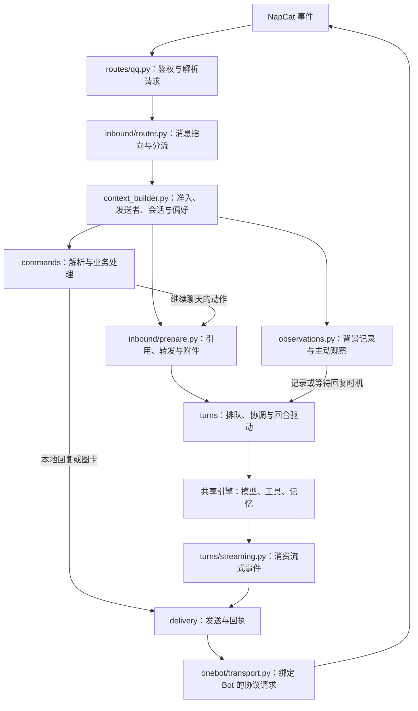

# QQ 开发地图

这里是 QQ 通道的现行导航。先按要改的行为选模块，再沿输入和输出找共享服务。整理记录见[执行单](../../../docs/qq_module_responsibility_execution_plan_v1.md)，用户指令用法见[QQ 指令说明](../../../docs/qq_commands_v1.md)。

归属标准是：**按提供的能力放实现，按触发方式放入口。** 指令可以调用绘图和发送，但绘图属于 `cards/`，发送属于 `delivery/`。收到的 Ark、小程序或音乐卡片属于协议消息，和自己绘制的 PNG 图卡不同。

## 从消息到回复



`assembly.py` 构造每个 Bot 的组件、连接回调，不处理事件内容。HTTP 路由调用装配好的事件入口；其他宿主模块通过 `gateway.py` 使用 QQ。包内实现直接导入对应 owner，不能反向从 HTTP 路由或装配模块取业务函数。

实际分流顺序由 `inbound/router.py:QQInboundEventHandler.handle()` 决定：建立上下文，判断定向入口、命令目标、引用助手和插件请求；随后走背景记录、前置命令、业务命令或内容准备。普通聊天、背景消息和插件事件共享原有会话协调机制。

| 收到的内容 | 如何处理 |
| --- | --- |
| 文字、@、有序消息段 | `channelcore_onebot` 解析；上下文层确定说话人、群/私聊、指向和会话。@ 列表与正文分别保留。 |
| 引用回复 | `references.py` 查原消息并绑定作者、时间和媒体来源。入口已查过的引用结果传入内容准备，避免再查一次。 |
| 合并转发 | `references.py` 查询实际节点并投影引用来源；`attachment_context.py` 绑定附件来源。未解析到的节点提供不可用说明。 |
| 图片、文件、音频、视频 | 协议附件进入共享材料服务；QQ 层负责来源标签、防抖、就绪判断和群识图偏好。可用图片像素进入当前请求，否则按原机制等待或安排视觉后续回合；不把收到文件当成已经理解内容。 |
| JSON/XML、小程序、音乐分享 | 协议包保留识别出的结构和消息段，材料服务处理可读取的来源；QQ 不另写一份通用协议解析器。 |
| 戳一戳 | `notices.py` 区分戳助手与群友互戳。前者可进入回应回合，后者按群背景策略记录。其他不支持的通知返回明确原因。 |
| 插件消息/事件 | 入站插件适配负责消息发布与回合请求；完成通知经 `turns/plugin_turns.py` 接回原会话队列。 |

## 数据和状态归谁

`QQMessageContext` 是当前消息的 QQ 视图：说话人、会话、角色/服务目标、回复模式、引用/转发和媒体来源都在这里。`to_turn_payload()` 转为共享引擎输入，`to_delivery_context()` 保存后续交付所需的目标；两者用途不同。

- 群会话使用 `qq_group_shared_<群号>`；发送者单独记录。主人私聊的存储身份仍由共享主人会话映射决定，不能用群会话 ID 替代说话人。
- `preferences.py` 保存各 QQ 会话的选择；`profiles.py` 是 Bot 连接档案，不能用会话偏好覆盖连接账号。
- 防抖、表情去重、引用回执和昵称缓存各有唯一 owner，每个网关独立。网关暴露的既有字典引用仍指向 owner 的同一份状态。
- 正常忙碌回合由 QQ 队列适配接入共享 inbox；工具轮内主人干预由共享回合协调器处理。背景批次可合并记录，回应消息仍有自己的工单。
- 持久工单冻结当时的目标和来源；恢复已准入的消息不会再次当作新 webhook 准入。原生图片 base64 不写入工单，领取时从已登记的材料重新准备。
- MemCore、工具结果投影、压缩和私聊向群聊的单向记忆镜像继续由共享服务管理。QQ 层不另存一套摘要或角色状态。

## 逐文件定位

所有 `__init__.py` 只标明包边界，不在导入时创建 Bot、队列或连接。

### 包根与 HTTP

| 文件 | 提供的能力 |
| --- | --- |
| [../../routes/qq.py](../../routes/qq.py) | HTTP URL、鉴权、账号校验、请求解析和响应；调用事件入口，不导出业务工具函数。 |
| [assembly.py](assembly.py) | `build_qq_event_handler()` 装配插件桥接、队列、回合、命令、内容准备和背景处理；连接共享监督器与发送回调。 |
| [gateway.py](gateway.py) | `NapCatQQGateway` 是外部 QQ 接口；保持现有方法签名，委托给各领域实现。新增业务放进 owner。 |
| [context.py](context.py) | `QQMessageContext` 及消息链、回合输入、交付目标的视图转换。 |
| [identity.py](identity.py) | 私聊/群/主人身份、发送者和 @ 标签、Bot 昵称及群成员缓存。 |
| [profiles.py](profiles.py) | Bot 账号和 NapCat 连接档案的读取、校验与公开快照；不公开密钥。 |
| [preferences.py](preferences.py) | 角色、服装、回复模式、模型、群识图/表情/主动观察等会话选择，原子保存与恢复。 |
| [constants.py](constants.py) | QQ 支持值、状态版本和传输常量。 |
| [validation.py](validation.py) | QQ 的角色、模型、服装、会话键和文件名规范化；保留实际传输限制。 |
| [formatting.py](formatting.py) | 入站、指令和交付共用的文字空白规范化与时间显示。 |
| [resources.py](resources.py) | QQ 角色资源清单与当前服装映射，调用共享角色资源服务；附件就绪判断在 `inbound/attachments.py`。 |

### `onebot/`：协议请求与动作

| 文件 | 提供的能力 |
| --- | --- |
| [transport.py](onebot/transport.py) | `OneBotActionTransport` 用绑定的账号、URL 和鉴权发送协议请求；查询与交付共用它。 |
| [model_actions.py](onebot/model_actions.py) | 模型可调用的 OneBot 动作目录、参数和目标定义。宿主工具 handler 在 `../../tool_handlers/qq_onebot.py`。 |
| [miniapp.py](onebot/miniapp.py) | Ark/小程序卡片适配、卡片状态与引用；不是图片绘制。 |

### `inbound/`：事件、来源与内容准备

| 文件 | 提供的能力 |
| --- | --- |
| [router.py](inbound/router.py) | `QQInboundEventHandler` 编排入站分流、命令和内容准备，把回合交给 runner；汇报真实交付结果。 |
| [context_builder.py](inbound/context_builder.py) | `QQInboundRuntime` 将准入后的普通消息或通知转为 QQ 上下文，判断回应与背景记录。 |
| [notices.py](inbound/notices.py) | 戳一戳等受支持通知的协议规范化与观察/回应分类。 |
| [references.py](inbound/references.py) | `QQEvidenceResolver` 查询引用和转发，投影作者/时间与不可用说明；`prepare_message_references()` 将结果合入当前上下文。 |
| [attachment_context.py](inbound/attachment_context.py) | 附件发送者标签、合并、句柄和视觉后续消息的模型输入投影；不负责下载、绘图或发送。发送者权限标签归 `identity.py`。 |
| [prepare.py](inbound/prepare.py) | `QQContentPreparation` 按顺序准备引用、转发和附件，调用共享材料/视觉服务，返回 `QQPreparedContent` 或已安排的后续响应。 |
| [attachments.py](inbound/attachments.py) | 每个网关的附件防抖、就绪等待值和待完成图片 ID 判断；不存储媒体正文。 |
| [observations.py](inbound/observations.py) | 未唤醒群消息的记录策略和背景工单入口，交给队列与主动观察模块。 |
| [record_ids.py](inbound/record_ids.py) | 已准入 QQ 背景记录的稳定来源 ID，供队列和共享入库复用，避免重放重复写入。 |
| [plugin_input.py](inbound/plugin_input.py) | 插件调用上下文、入站发布和请求标记，以及后续任务与插件请求的关联。 |

### `turns/`：排队、驱动与回复准备

| 文件 | 提供的能力 |
| --- | --- |
| [runner.py](turns/runner.py) | `QQTurnRunner` 准备引擎输入、接入停止/干预/队列协调，运行共享引擎并记录失败交付。 |
| [streaming.py](turns/streaming.py) | 消费共享引擎的中途消息、工具交付和最终回复事件，调用交付模块，汇总结果与耗时。 |
| [queue.py](turns/queue.py) | `QQSessionQueue` 适配共享持久队列，领取、恢复、合并背景记录及提交回应/插件回合；不再实现另一套队列库。 |
| [work.py](turns/work.py) | QQ 工单载荷、会话工作键、排队时长、背景批次键与重试让行判断。 |
| [recovery.py](turns/recovery.py) | 校验并恢复已准入的背景事件，复用当时冻结的目标，重建媒体与 @ 来源。 |
| [attention.py](turns/attention.py) | 群主动观察的调度、候选审核和回合接入，遵守忙碌和背景记录状态。 |
| [attention_state.py](turns/attention_state.py) | 主动观察候选、冷却、票据与生命周期状态。 |
| [followups.py](turns/followups.py) | 视觉结果完成、审批后恢复等后续回合；复用 runner 的输入与执行入口。 |
| [plugin_turns.py](turns/plugin_turns.py) | 将插件主动事件或完成通知接回正确的 QQ 目标与队列。 |
| [reply_audio.py](turns/reply_audio.py) | `prepare_qq_reply_audio()` 选择待说内容；随后复用 QQ 声线/参考、共享 TTS 和音频缓存，返回音频文件或真实失败，不发送消息。 |

### `commands/`：语法与业务编排

| 文件 | 提供的能力 |
| --- | --- |
| [parser.py](commands/parser.py) | 正式指令、参数解析和帮助元数据的单一权威。`kind` 表达语法形态，业务按指令名分派。 |
| [handler.py](commands/handler.py) | `QQCommandHandler` 前置检查和显式分派；分别返回本地结果、动作后继续聊天或外部接管。 |
| [card_results.py](commands/card_results.py) | 指令结果的图卡工作流：准备业务文档、调用 renderer，再委托交付；不实现 OneBot 发送。 |
| [characters.py](commands/characters.py) | QQ 角色和服装选择，调用角色资源与会话偏好。 |
| [models.py](commands/models.py) | QQ 模型与回复方式查询/选择；模型 API 和配置权威仍在共享服务。 |
| [administration.py](commands/administration.py) | QQ 管理、权限和审批的业务适配，不重写权限系统。 |
| [care.py](commands/care.py) | 签到、养成状态、戳角色等 QQ 互动，调用共享养成服务。 |
| [commerce.py](commands/commerce.py) | 商店、背包、购买和投喂命令；交易与库存权威由共享服务维护。 |
| [care_results.py](commands/care_results.py) | 养成/商品结果的 QQ 文本和当前请求展示数据，不保存另一份长期状态。 |
| [emotions.py](commands/emotions.py) | `/表情包` 绑定材料的提取、主人校验和配置片段回执；自动表情发送在交付层。 |
| [poke.py](commands/poke.py) | 戳角色互动的结算与可选材料，和收到通知的协议规范化分开。 |
| [workspace.py](commands/workspace.py) | `/材料` 解析适配及工作区列表/清理结果显示，文件管理调用共享服务。 |

### `cards/`：图卡制作

| 文件 | 提供的能力 |
| --- | --- |
| [help.py](cards/help.py) | 帮助文档的排版、绘制和图片缓存。 |
| [care.py](cards/care.py) | 养成快照的状态图内容、布局和绘制。 |
| [commerce.py](cards/commerce.py) | 商店、背包和购买回执的文档组织、商品配图与绘制。 |
| [cache.py](cards/cache.py) | 日缓存统计图的布局与绘制；统计数据由共享服务提供。 |

字体、底图和原子图片缓存共用 [rendering/card_artwork.py](../../rendering/card_artwork.py)。通用图文工具共用 [rendering/text_cards.py](../../rendering/text_cards.py)，两者都不属于 QQ 发送代码。

### `delivery/`：发送与回执

| 文件 | 提供的能力 |
| --- | --- |
| [actions.py](delivery/actions.py) | QQ 模型动作的目标绑定、插件发送 Hook、可见回执、近期 Bot 消息和连通性诊断；网络请求交给协议层。 |
| [messages.py](delivery/messages.py) | 文字、引用、音乐卡片、贴纸及批量制品的发送格式和回执；使用 SDK 引用策略。 |
| [media.py](delivery/media.py) | 图片、音频和文件的上传/发送、路径适配与协议失败回退；不制作文件正文。 |
| [replies.py](delivery/replies.py) | 回复模式、文字/声音交付与回退编排，消费音频准备的结果。双模式先发可用文字，再调用音频准备；保持真实失败原因。 |
| [stream.py](delivery/stream.py) | 中途文字分段、按出现次数去重、已发送前缀和最终补交付；不是模型流的解析循环。 |
| [emotions.py](delivery/emotions.py) | 最终表情选择与发送、会话限频、并发去重和失败后重试。 |
| [artifacts.py](delivery/artifacts.py) | 工具/插件制品事件的交付身份、可见回执和受管文件补齐；制品生成属于原工具/插件。 |
| [tool_port.py](delivery/tool_port.py) | 给共享工具的 QQ 交付端口，恢复当前目标后发送音乐、音频或 OneBot 动作。 |
| [context.py](delivery/context.py) | 从保存的后台交付目标重建 `QQMessageContext`；不重新接收事件。 |
| [notes.py](delivery/notes.py) | 一次性交付反馈的线程安全存取，在下一次 QQ 上下文消费。 |
| [card_results.py](delivery/card_results.py) | 发送已经绘制好的图卡、执行文字回退并保留真实回执；不调用 renderer。 |

## QQ 调用的共享服务

| 能力与实现 | QQ 传入 | 返回/归属 |
| --- | --- | --- |
| `channelcore_onebot`，见[宿主集成](../../../docs/channelcore_onebot_akane_integration_v0.md) | 绑定 Bot 的事件、动作参数和协议响应 | 有序消息、作者/附件、准入和动作结果；SDK 是独立依赖。 |
| [dialogue_targets.py](../../dialogue_targets.py) | 定向正文、角色与插件入口 | 可信角色/服务目标与记忆域；命令路由不另造身份。 |
| [session_inbox.py](../../session_inbox.py)、[durable_session_queue.py](../../durable_session_queue.py)、[turn_coordination.py](../../turn_coordination.py) | 原会话身份、工单、当前回合与干预 | 持久排队、领取/恢复、停止和工具轮追加；QQ 只适配数据。 |
| [engine.py](../../engine.py) 与 `engine_services/` | `to_turn_payload()`、来源、材料、当前偏好 | 模型/工具循环和输出事件。提示、工具定义和模型恢复在共享引擎。 |
| [owner_private_session.py](../../owner_private_session.py)、[owner_private_group_memory.py](../../owner_private_group_memory.py)、[memcore_integration/](../../memcore_integration/) | 当前身份、已记录消息与来源 | 主人存储映射、单向镜像、记忆检索和压缩；不归 QQ 队列所有。 |
| [attachment_ingest.py](../../attachment_ingest.py)、[attachment_inbox.py](../../attachment_inbox.py)、[desktop_pet_engine.py](../../desktop_pet_engine.py) | QQ 附件描述、作者/引用来源和材料 ID | 登记、下载、读取、视觉结果/像素和工作区材料。QQ 专用下载来源适配仍由材料服务管理，避免拆开其存储与生命周期。 |
| [care_runtime.py](../../care_runtime.py) 与角色资源服务 | 角色、会话、真实操作人、动作 | 养成/关系、库存/交易和资源快照；图卡只使用展示数据。 |
| [services/tts_client.py](../../../services/tts_client.py)、[voice_runtime/](../../voice_runtime/) | 文字或 utterances、声线/情绪、语言和参考 | 合成音频；QQ 的路径和发送格式随后由交付层处理。 |
| [plugin_api.py](../../plugin_api.py) 与当前 Bot 的 broker | 消息视图、可信目标、请求/完成标记 | 插件命令、事件或交付制品；不从历史字符串猜权限。 |
| [media_audio_urls.py](../../media_audio_urls.py) | 公开音频 URL | 通用预检/下载规则，多个工具可复用，不绑定 QQ 会话。 |

共享引擎中一些历史入口仍位于 [engine_services/desktop_care_pet.py](../../engine_services/desktop_care_pet.py)：`ingest_qq_attachments` 委托材料服务，`record_passive_qq_message(s)` 写共享 Store/MemCore 并安排维护。它们不属于桌面 UI；该文件的整体拆分涉及其他客户端，单独安排。QQ 来源 ID 已抽到 `inbound/record_ids.py`，队列和入库复用同一规则。

## 常见修改与最小验证

在仓库根目录执行测试。修改实现直接导入 owner；不要为了测试在 HTTP 路由或网关补一组无调用者的函数别名。

| 要改什么 | 最小阅读路径 | 优先验证 |
| --- | --- | --- |
| 唤醒、回复助手、群友互戳 | `inbound/context_builder` → `router` → `references/notices` | `test_qq_channelcore_admission`、`test_qq_nickname_addressing`、`test_qq_group_notices`、`test_qq_forward_source_binding` |
| 图片来源、引用/转发和识图 | `inbound/references` → `attachment_context` → `prepare` → 共享材料入口 | `test_qq_rich_materials`、`test_qq_forward_source_binding`、`test_qq_group_identity` |
| 正式指令 | `commands/parser` → `handler` → 领域模块 | `test_qq_command_dispatch`、`test_qq_commands`；新增流程见[指令开发指南](../../../docs/qq_commands_v1.md#开发者入口与新增指令指南) |
| 图卡外观/回退 | `cards/<类型>` → `commands/card_results` → `delivery/card_results` | 对应 `test_qq_*_cards`、`test_qq_cache_cards`、`test_qq_commands` |
| 声音选择/文字与声音模式 | `turns/reply_audio` → `delivery/replies` → `media` | `test_qq_voice_delivery`、`test_tts_provider_selection`、`test_reply_voice_recovery` |
| 发送、分段、重复或漏消息 | `turns/streaming` → `delivery/stream/messages/media/artifacts` | `test_qq_stream_replay`、`test_qq_delivery_identity_contract`、`test_plugin_artifact_delivery` |
| 忙时排队、工具轮干预、重启恢复 | `turns/runner` → `queue/work/recovery` → 共享协调器/队列 | `test_qq_queue_processing_fence`、`test_qq_passive_memory_recovery`、`test_host_completion_batch` |
| 主动搭话与插件事件 | `inbound/observations/plugin_input` → `turns/attention/plugin_turns` | `test_qq_group_attention`、`test_qq_plugin_runtime_wiring`、`test_plugin_qq_inbound_turns` |
| 模型/角色/群偏好 | 对应 `commands/` 模块 → `preferences`；Bot 连接看 `profiles` | `test_qq_gateway_modules`、`test_qq_channel_profiles`、`test_qq_multi_bot_dispatch` |

例如：

```powershell
python -m unittest tests.test_qq_command_dispatch tests.test_qq_commands
python -m unittest tests.test_qq_queue_processing_fence tests.test_qq_passive_memory_recovery
python -m unittest discover -s tests -p "test_qq*.py"
git diff --check
```

## 生效与排查

后端源码更改需要更新运行实例并重启，步骤见[源码到运行实例](../../../docs/source_to_runtime_update_v1.md)。纯 QQ 后端改动无需重新构建桌宠。持久工单、会话偏好和记忆的数据位置与格式不随目录整理迁移；模型输入字段、工具定义和提示渲染也不因文件位置改变。

先确认实际运行版本和 Bot，再看事件 `reason`、`delivery_status` 与回合结果：`queued` 是已入队，`buffered` 是附件防抖或后续识图已安排，`ignored` 是明确的入站分流，`send_failed` 是交付失败。HTTP 响应里不带 OneBot 的快速 `reply` 字段，避免已经显式发送后再次发送。

慢请求按阶段判断：`queue_wait_ms`、`turn_processing_ms`、`file_delivery_ms`、`text_and_voice_delivery_ms`、`emotion_delivery_ms` 等来自实际 QQ 路径；共享引擎另有本地准备和模型请求耗时。不能把排队、视觉或 TTS 等待都归到聊天服务商，也不能用隔离替身的耗时证明真实网络或缓存表现。日志和诊断只查看必要字段，避免输出凭据与媒体正文。
